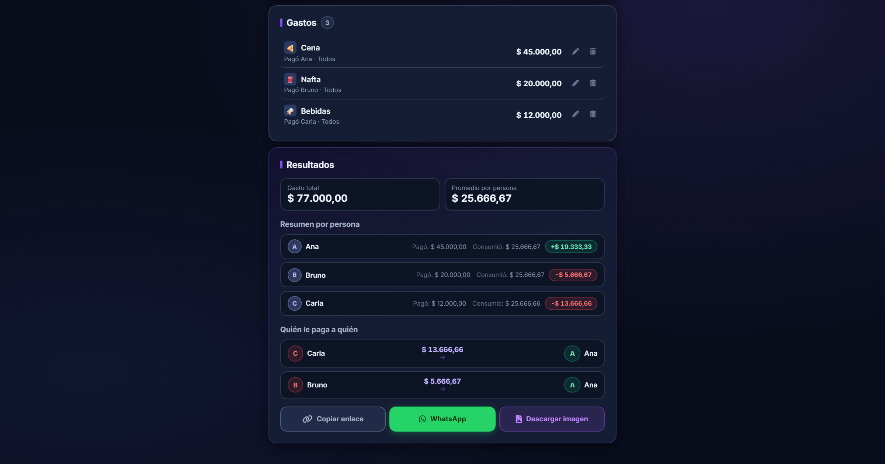
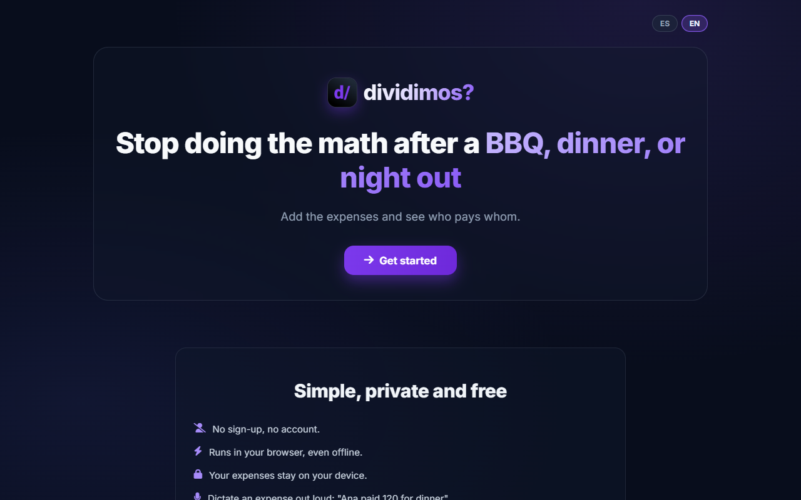

[Read in English](README.md)

# dividimos?

Dividí gastos grupales sin cuenta ni servidor. Cargás quién pagó qué y la app dice quién le paga a quién, con la menor cantidad de transferencias.

[](https://github.com/benjaespina98/webdomain/actions/workflows/ci.yml)
[](LICENSE)
[](https://angular.dev)

**Demo en producción:** https://dividimos.vercel.app





## Funcionalidades

- Dividí un gasto en partes iguales, entre algunas personas o por montos exactos por persona.
- Menor cantidad de transferencias para saldar a todos (búsqueda exacta hasta 16 personas), calculada en centavos enteros.
- Alias o CBU opcional por persona, que se muestra a quien tiene que recibir plata.
- Compartí un enlace (los datos van en el fragmento de la URL y nunca se envían a un servidor) o un mensaje corto de WhatsApp.
- Descargá el resumen como imagen PNG.
- Dictá un gasto por voz donde el navegador lo permite.
- Funciona sin conexión como PWA instalable. Los datos quedan en el navegador, sin registro.
- Español e inglés.

## Stack

| Área | Tecnología |
| --- | --- |
| Frontend | Angular 21.2, TypeScript 5.9, RxJS 7.8, SCSS, PWA con Angular Service Worker |
| Backend | Ninguno (app estática) |
| Datos | localStorage del navegador, enlaces comprimidos con lz-string |
| Testing | Karma y Jasmine, ESLint con angular-eslint |
| Deploy | Vercel, CI en GitHub Actions (Node 22) |

## Correr localmente

```bash
git clone https://github.com/benjaespina98/webdomain.git
cd webdomain/angularPage
npm install
npm start
```

Abrí http://localhost:4200. No hay archivo `.env`; la configuración está en `angularPage/src/environments/`.

| Configuración | Para qué sirve |
| --- | --- |
| `posthogApiKey` | Conteo de uso anónimo opcional. Vacía lo desactiva. |
| `posthogHost` | Host de PostHog. |
| `coffeeUrl` | Enlace de apoyo. Vacío lo oculta. |

## Tests

`npm test` corre los tests unitarios (13 archivos de spec). Cubren el algoritmo de liquidación, los enlaces compartidos, la persistencia y sus migraciones, el mensaje de WhatsApp y el comportamiento de los componentes. `npm run lint` corre ESLint.

## Estructura del proyecto

```text
.github/       CI y Dependabot
angularPage/   App Angular (src/app, scripts, configuración)
docs/          Documentación y capturas
```

## Más documentación

- [Arquitectura](docs/architecture.md): estado, algoritmo de liquidación, enlaces compartidos, privacidad (en inglés).
- [Despliegue y chequeos](docs/deployment.md): Vercel, CI, configuración, vista previa social (en inglés).
- [Roadmap](docs/roadmap.md): ideas que todavía no existen (en inglés).

## Autor

Benjamín Espina: [LinkedIn](https://linkedin.com/in/benjamin-espina) | [GitHub](https://github.com/benjaespina98) | [Portfolio](https://benjaminespina.com)

## Licencia

MIT. Ver [LICENSE](LICENSE).
