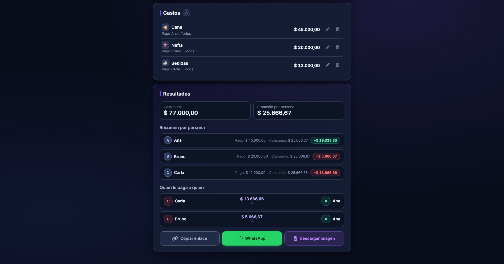
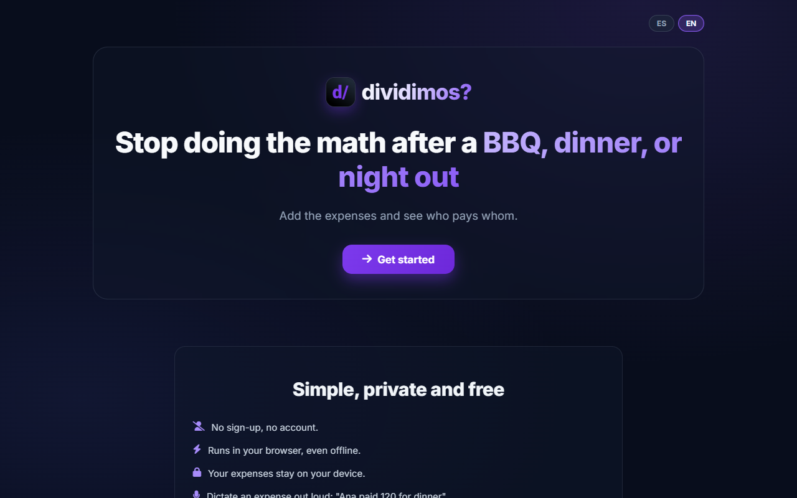

[Leer en español](README.es.md)

# dividimos?

Split group expenses without an account or a server. Add who paid what and the app tells everyone who owes whom, with the fewest transfers.

[](https://github.com/benjaespina98/webdomain/actions/workflows/ci.yml)
[](LICENSE)
[](https://angular.dev)

**Live demo:** https://dividimos.vercel.app





## Features

- Split an expense equally, among some people, or by exact amounts per person.
- Fewest transfers to settle everyone (exact search up to 16 people), computed in integer cents.
- Optional alias or CBU per person, shown to whoever has to receive money.
- Share a link (the data lives in the URL fragment, never sent to a server) or a short WhatsApp message.
- Download the summary as a PNG image.
- Dictate an expense by voice where the browser supports it.
- Works offline as an installable PWA. Data stays in the browser, no sign up.
- Spanish and English.

## Stack

| Area | Technology |
| --- | --- |
| Frontend | Angular 21.2, TypeScript 5.9, RxJS 7.8, SCSS, PWA with Angular Service Worker |
| Backend | None (static app) |
| Data | Browser localStorage, share links compressed with lz-string |
| Testing | Karma and Jasmine, ESLint with angular-eslint |
| Deploy | Vercel, CI on GitHub Actions (Node 22) |

## Run locally

```bash
git clone https://github.com/benjaespina98/webdomain.git
cd webdomain/angularPage
npm install
npm start
```

Open http://localhost:4200. There is no `.env` file; settings live in `angularPage/src/environments/`.

| Setting | Purpose |
| --- | --- |
| `posthogApiKey` | Optional anonymous usage counting. Empty disables it. |
| `posthogHost` | PostHog host. |
| `coffeeUrl` | Support link. Empty hides it. |

## Tests

`npm test` runs the unit tests (13 spec files). They cover the settlement algorithm, share links, persistence and migrations, the WhatsApp message and component behavior. `npm run lint` runs ESLint.

## Project structure

```text
.github/       CI and Dependabot
angularPage/   Angular app (src/app, scripts, config)
docs/          Documentation and screenshots
```

## More documentation

- [Architecture](docs/architecture.md): state, settlement algorithm, share links, privacy.
- [Deployment and checks](docs/deployment.md): Vercel, CI, configuration, social preview.
- [Roadmap](docs/roadmap.md): ideas not implemented yet.

## Author

Benjamín Espina: [LinkedIn](https://linkedin.com/in/benjamin-espina) | [GitHub](https://github.com/benjaespina98) | [Portfolio](https://benjaminespina.com)

## License

MIT. See [LICENSE](LICENSE).
